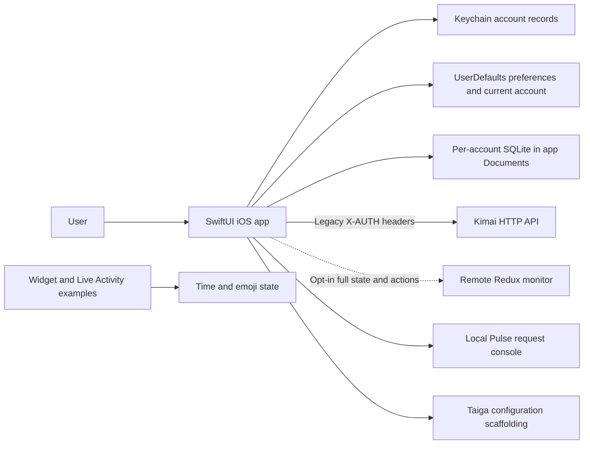
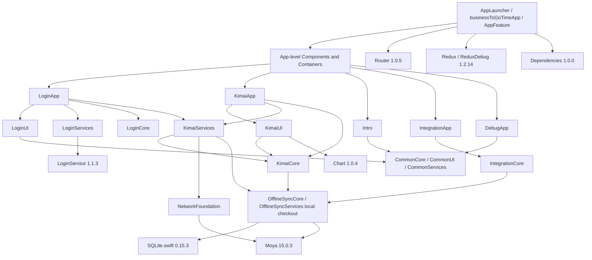

# Current architecture

Source-backed view of revision `de9e71e`, reviewed 2026-10-25. This describes **what exists**, including incomplete wiring, not a proposed restructuring. App runtime verification is blocked by [baseline issues](../app-review/BASELINE.md). External behavior was checked against the workspace-pinned sources listed in [findings](../app-review/FINDINGS.md#external-source-references).

## Context and boundaries



- The app is the client; there is no backend server in this repository.
- Taiga configuration exists, but no active Taiga API/project-management implementation was found. The diagram does not imply Taiga network calls.
- Widget/Live Activity have no observed app-state/database sharing path. Their example state is separate.

## Building blocks and dependency map

Arrows below mean imports/dependencies, not runtime invocation order. The map groups related targets; it is intentionally not every transitive SwiftPM edge.



| Owner | Responsibility / source |
|---|---|
| App shell | [AppLauncher](../../businessToGoTime/AppLauncher.swift) chooses production vs unit-test app. [businessToGoTimeApp](../../businessToGoTime/businessToGoTimeApp.swift) initializes capture, DI mode, root store and monitor. |
| App orchestration | [AppFeature](../../businessToGoTime/App/AppFeature.swift) owns root state and dispatches child reducers; coordinates login/sync, logout/reset and global routing. |
| UI composition | [Components](../../Components) contains Login/Kimai/Today/Management/Report/Settings/Assistant projections and containers. Projection types derive state and lift UI actions; they are not independent data stores/services. |
| Kimai | [Package](../../Modules/Kimai/Package.swift) exposes Core, UI, Services, App targets. Core is not fully infrastructure-free: models conform to OfflineSync protocols. Reducer performs orchestration and synchronous service calls. |
| Login | [Package](../../Modules/Login/Package.swift) exposes Core/UI/Services/App; account records depend on external LoginService. Login reducer selects credentials and per-account database. |
| Intro / Debug | Intro displays pages and consumes the first-run preference. Debug reducer writes mock/remote-log preferences. |
| Integration | State and `onConnect` action exist, but reducer is no-op. `Sources/Services/IntegrationService.swift` is not included in declared targets and uses stale APIs. Do not treat it as active persistence. |
| Common / Foundation | Common contains formatting, date helpers, preferences and shared UI resources. CommonUI owns the adaptive teal/mint action color, contrasting action foreground, and compact icon-button dimensions; the app applies the action tint globally. NetworkFoundation supplies a Moya decoding helper. RequestFoundation is legacy/unwired in the inspected app graph with undeclared dependencies. |
| External libraries | Redux/DI supply store/effect/global dependency behavior; OfflineSync owns repository/change tracking/sync; LoginService owns Keychain/current-account adapters. |

OfflineSync is temporarily resolved from the local checkout specified in [developer setup](../development/SETUP.md#local-offlinesync-iteration), not the former 1.3.9 pin. The local implementation now includes the transactional/revision-aware fixes described in [sync architecture](SYNC.md), verified by [isolated regression tests](../testing/SYNC-REGRESSIONS.md).

The current structure is feature-oriented but not strict clean architecture: app reducers call concrete services, UI contains calculations, CommonCore contains a SwiftUI JSON viewer, and external persistence concerns appear in core models. These are observations, not authorization for a big-bang rewrite.

## State, lifetimes and effects

- `businessToGoTimeApp.store` owns `StoreOf<AppFeature>` for the app lifetime. Root state contains `login`, `kimai`, `integration`, `report`, `intro`, `debug`.
- Kimai state caches customer/project/activity/timesheet/team/user arrays, pending-change arrays, selected team and sync status. SQLite is persistent storage; state arrays are projections/snapshots, not a transactional mirror.
- The Projects tab groups projects under customer rows. Customer and project actions use existing sheets and delete flows; project creation starts with the selected customer. Search retains all projects for matching customers and otherwise only matching projects, while the selected team still filters customers. The Today and Projects views share the folder-row presentation.
- Report state owns selected date/project/period and month names. Filtering/aggregation also exists in `ReportsView`, `ReportViewModel` and model helpers.
- Redux 1.2.14 `Store.send` reduces synchronously, subscribes to the returned Combine effect, then invokes configured middlewares with updated state/action. Emitted actions re-enter `send` on the main queue. `Effect<Action>` is `AnyPublisher<Action, Error>`; `.run` creates a Task inside a Future.
- The only configured middleware is `MonitorMiddleware.handle`. Side effects in Login/Kimai reducers are not separate middleware implementations.
- Dependencies 1.0.0 is a custom global registry, not swift-dependencies' task-local context: `.mode` chooses mutable static live/mock values; property wrappers resolve on access. Many mock/live service values are long-lived static objects. A test store sets global mode to mock but does not provide per-test isolation automatically.
- Router's mock value aliases its live object. Kimai's coordinator invalidates old tasks on account/configuration changes; immutable per-session request origins/credentials and reducer completion IDs prevent old work from following the current account. See [sync lifetime](SYNC.md#account-lifetime).

## Runtime flows

### Startup and account restoration

```mermaid
sequenceDiagram
    participant Launch as AppLauncher
    participant App as businessToGoTimeApp
    participant Root as AppContainer / router
    participant Login as LoginFeature
    participant Storage as Keychain and SQLite
    participant Parent as AppFeature
    Launch->>App: Normal launch (no XCTestCase class)
    App->>App: Enable URLSession capture; choose DI mode; create store/monitor
    App->>Root: Render accounts root
    Root->>Parent: intro.load on appear
    Parent->>Root: Optional intro sheet via delegate
    Root->>Login: fetchAccounts when account list appears
    Login->>Storage: getAccounts / getCurrentAccount
    opt Current account exists
        Login->>Storage: switchDB(account filename); mark current
        Login->>Parent: delegate.onLogin(account)
        Parent->>Parent: loginKimai(account)
    end
```

If `NSClassFromString("XCTestCase")` is present, AppLauncher opens `TestApp` instead. This supports hosted unit tests but is not a safe E2E launch contract by itself. XCUITest must verify it launched the real UI.

### Login and sync

```mermaid
sequenceDiagram
    participant UI as Account UI
    participant L as LoginFeature
    participant A as AppFeature
    participant K as KimaiService
    participant R as KimaiFeature
    participant S as Customer / Record services
    participant DB as SQLite
    participant API as Kimai API
    UI->>L: login(account identifier)
    L->>DB: Switch per-account connection
    L->>A: delegate.onLogin(account)
    A->>K: setAuth; login(server)
    K->>K: Set global API URL; return true (no auth check)
    A->>R: kimai.sync
    R->>S: Read local records/change queues
    S->>DB: Query repositories
    R->>S: Sync customers, projects, activities, users, timesheets sequentially
    S->>API: Fetch / upload pending changes
    S->>DB: Merge records and acknowledge changes
    alt Thrown sync error
        R->>R: syncFailed (local state may already be changed)
    else Success
        R->>R: synced arrays; status idle; reload change queues
    end
```

- Customer fetch returns customer DTOs and unique teams, which are persisted for offline use. Generic fetch propagates errors; status/decoding/pagination failures cannot become authoritative empty data.
- If no Kimai configuration exists, `loginKimai` reads offline state without remote authentication.
- Logout/reset invalidates the sync generation/task, clears Kimai/integration state and routes to accounts. Reset deletes only the known account database filenames.

### Local edit and delete

```mermaid
sequenceDiagram
    participant UI as Timesheet sheet
    participant C as Component action projection
    participant R as KimaiFeature
    participant S as KimaiService / RecordService
    participant DB as SQLite repository and track table
    UI->>C: saveTapped(model)
    C->>R: timesheet.save(model)
    R->>S: save(model)
    S->>DB: Create or update; track insert/update
    R->>S: Reload records and pending changes
    R->>UI: State publication refreshes view
```

Local saves do not themselves guarantee immediate sync. Delete guards/popups are reducer delegates. Synced customer/project/activity rows are generally hidden via `visible = false`; unsynced inserts can be deleted outright. Timesheets have a remote DELETE endpoint. Do not generalize one deletion policy to all models.

## Storage and schema contracts

| Storage | Current representation / ownership |
|---|---|
| Keychain | LoginService serializes whole `Account` (identifier/name, Kimai/Taiga server/username/password). App adapter uses service string `de.selch`. Remove-all is not service-scoped; see F5. |
| UserDefaults | `currentAccount` string from LoginService; Common wrapper stores Codable Data for `isIntro` (default true), `isMock` and `isRemoteLog` (default false). Most writes use the standard suite, not a test namespace. |
| SQLite file | OfflineSync opens app Documents / `businessToGo_<identifier>.sqlite` when LoginFeature selects an account. Initial live database has no filename/connection. |
| Model tables | `kimai_customers`, `kimai_teams`, `kimai_projects`, `kimai_activities`, `kimai_timesheets`, `kimai_users`. Repositories generate columns using reflection over `Model()`; `id` is primary key, primitive optionals map to nullable columns, other fields default to string columns. Array encoding/decoding uses SQLite.swift's Codable support; customer/team IDs and timesheet relationship round trips are exercised by the sync integration suite. |
| Change tracking | `track` keeps the same columns, with a fresh timestamp/UUID revision on each mutation. Record+queue+baseline changes are transactional; successful acknowledgements clear only the revision uploaded. `sync_uploads` journals POST intents/receipts. Errors throw. |
| Relationships | Project.customer → customer; Activity.project → project; Timesheet.project/activity → project/activity. Customer teams store team IDs, separate from fetched team DTOs. |
| Mapping | Model foreign-key declarations register `sync_relationships`; server ID acknowledgements atomically update child rows and `sync_id_mapping`. Stale local identities are resolved on subsequent edits/deletes/creates. |
| Schema evolution | No versioned app schema migration policy established. `CREATE IF NOT EXISTS` plus reflection is not a migration strategy; do not promise old data compatibility. |

### Observed conflict/retry semantics, not guarantees

Current sync never infers deletion from snapshot absence. It retains pending edits, compares saved baselines to observed server records, acknowledges each successful upload independently, and preserves newer revisions. Ambiguous POSTs stop until a matching server record is independently confirmed. See [sync safety, checkpoints and server-contract limits](SYNC.md); the old F2–F4 findings describe the former 1.3.9 implementation.

## HTTP boundary

- [KimaiAPI](../../Modules/Kimai/Sources/Services/KimaiAPI.swift) maps customer/project/activity/timesheet CRUD plus teams/users/me. The actual sync path derives teams from customers; enum cases alone do not establish use.
- Timesheets use validated pagination (`size=500`, stable ascending ID order, bounded concurrency), persistent UTC `modified_after` checkpoints and periodic full refresh. Pending delta writes re-fetch individual records. Other collections still refresh fully.
- Generic writes use JSON; timesheet begin/end/description come directly from model strings/optionals. Customer writes hardcode DE/EUR/Europe-Berlin defaults. Optional serialization and latest endpoint permissions need contract tests.
- `KimaiAuthPlugin` still adds legacy X-AUTH headers, but captures immutable account credentials and origin/path prefix. Unconfigured targets use `.invalid`; account database bindings reject switching to another server/user.
- RequestService validates HTTP status before JSONDecoder and bridges task cancellation to the Moya request/continuation. Controlled tests cover decodable HTTP errors, cancellation, empty collections and pagination failures; no real-server compatibility result is claimed.
- Latest Kimai's documented Bearer auth and distinct write/read timestamp formats differ from current behavior. This document does not describe an already-completed migration.

## Historical artifacts and future work

- [Historical architecture image](../../Doc/AppArchitecture.png) includes full Taiga and Management package boundaries absent from this revision.
- [Historical flow PDF](../../Doc/Flow.pdf) includes planned backlog/sprints/Kanban/issues. Parsed text was inspected; screenshot generation failed. It is product intent, not verified behavior.
- [Dependency graph](../../PackageDependencies.md) and [Redux state graph](../../Modules/redux_state.mmd) are retained as historical/generated aids; they are not current runtime lifecycle documentation.
- Future test composition is proposed separately in [DESIGN.md](../app-review/DESIGN.md). Future Taiga/widget features, dependency upgrades, async cancellation changes, schema migration and auth fixes require their own approved implementation scope.
